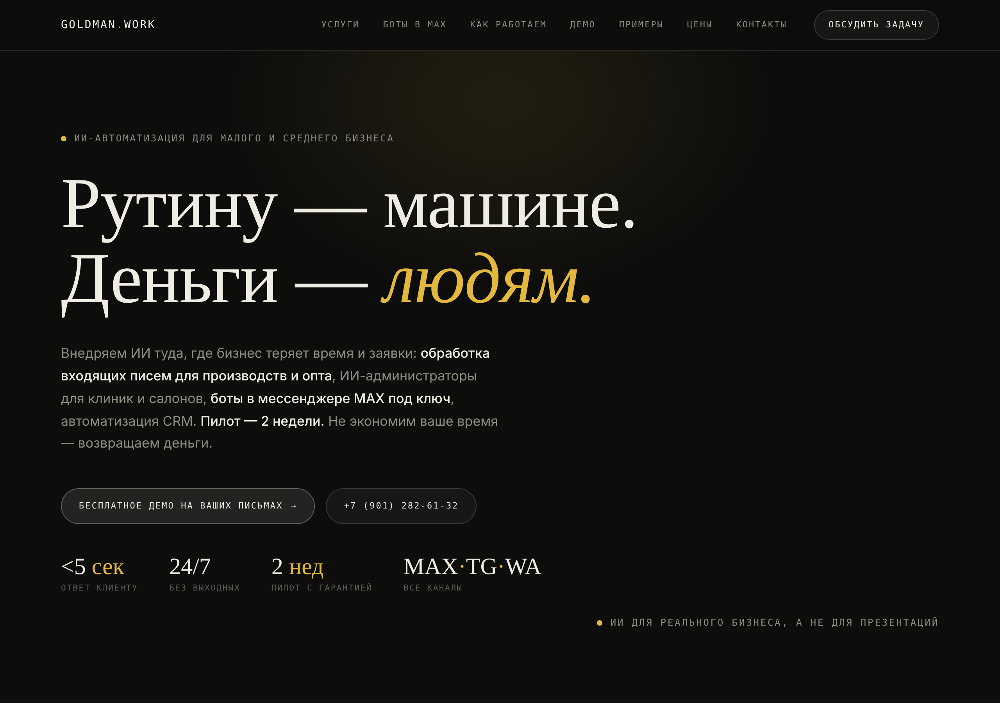
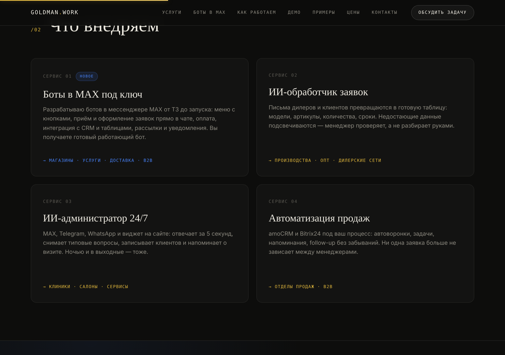
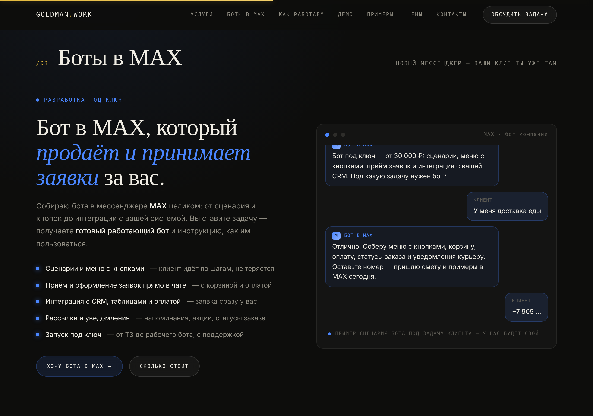
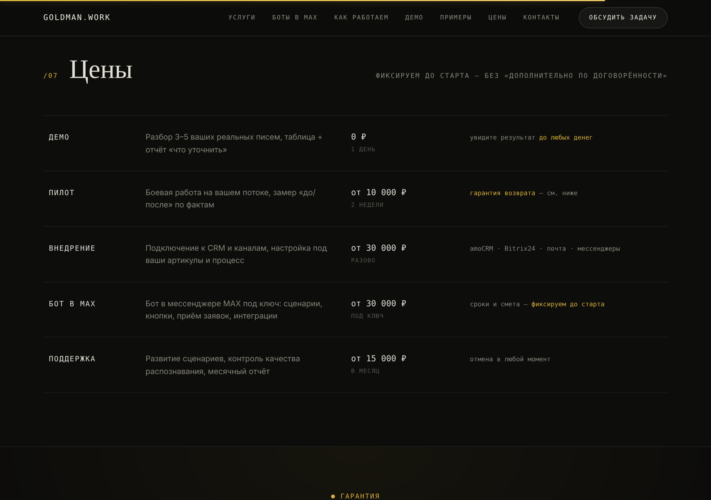
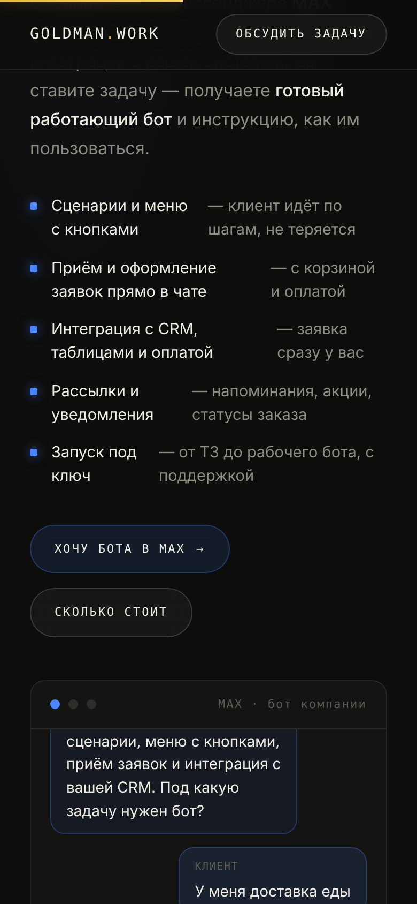

# Боты в MAX под ключ + редизайн лендинга — объяснение изменений

> Этот документ объясняет, что и зачем изменилось в `index.html`: добавлена услуга
> «Боты в MAX под ключ» и проведён редизайн лендинга GOLDMAN.WORK.

## Background

### Для тех, кто видит проект впервые

GOLDMAN.WORK — одностраничный лендинг (один файл `index.html`, ~750 строк) для
бизнеса по ИИ-автоматизации. Весь сайт — это HTML со встроенными `<style>` и
`<script>`, без сборщиков, фреймворков и зависимостей. Открываешь файл в браузере —
он работает. Такой подход называют **zero-build**: нет шага компиляции, весь код
едет как есть.

> 💡 **Дизайн-система** сайта задана через CSS-переменные в `:root`: тёмный фон
> (`--bg`), кремовый текст (`--cream`), золотой акцент (`--accent`), засечный шрифт
> для заголовков (`--serif`) и моноширинный для подписей (`--mono`). Благодаря этому
> любой новый блок достаточно собрать из тех же токенов — и он автоматически
> выглядит «в стиле».

На странице уже были секции: hero, «как работаем» (шаги + терминал), «что внедряем»
(3 карточки услуг), два живых демо (разбор письма и чат ИИ-администратора), примеры,
цены, гарантия и контакты. Секции пронумерованы `/01…/06`, навигация — якорные
ссылки на `id` секций.

### Что конкретно меняем

Задача: **добавить новую услугу — разработка ботов в мессенджере MAX под ключ** — и
**улучшить дизайн**. То есть нужно встроить новый смысловой блок в уже сложившуюся
вёрстку и визуальный язык, не сломав существующие демо и нумерацию.

## Intuition

Главная идея — не «прикрутить блок сбоку», а сделать MAX **полноценным жителем**
сайта: он должен появиться везде, где клиент ищет услугу (hero → навигация →
карточки → отдельная секция → прайс).

Чтобы MAX визуально выделялся как «новинка», но не спорил с золотой гаммой, введён
**второй акцентный цвет** — синий `--max:#4a86ff` (перекликается с брендом мессенджера
MAX). Золото остаётся «фирменным», синий работает как маркер «это про MAX».

> 🧩 Простая аналогия: золото — голос компании, синий — голос MAX. Там, где говорит
> MAX (карточка услуги, секция, демо-чат), включается синий акцент: рамки, маркеры
> списка, логотип-плашка «M». Остальной сайт продолжает «звучать золотом».

Чтобы секция про MAX не была статичной «простынёй текста», она сделана по тому же
принципу, что и остальные демо на сайте: окно чата, в котором **сам собой
разыгрывается сценарий** диалога клиента с MAX-ботом (печатает → отвечает). Это
показывает продукт в действии, а не описывает его словами.

## Code

Все правки — в одном файле `index.html`. Ниже — по группам.

**1. Новый акцентный цвет MAX** в дизайн-системе (`:root`):

```css
--max:#4a86ff; --max-soft:rgba(74,134,255,.12); --max-line:rgba(74,134,255,.28);
```

**2. Секция «Боты в MAX» (`/03`)** — две колонки: слева оффер + список возможностей
+ CTA, справа «живое» окно чата MAX-бота. Переиспользует существующие классы `.term`
и `.chat-body`, а синий акцент добавляется через класс-обёртку `.maxwin`:

```html
<section id="max" class="max-sec">
  ...
  <div class="term maxwin">
    <div class="term-bar">...<span>MAX · бот компании</span></div>
    <div class="chat-body" id="maxBody"></div>
  </div>
</section>
```

**3. Авто-демо чата** — короткий IIFE проигрывает сценарий, когда секция попадает в
поле зрения (через `IntersectionObserver`), с индикатором «бот печатает…». При
`prefers-reduced-motion` сразу показывает все реплики без анимации:

```js
if ("IntersectionObserver" in window && !prefersReducedMotion) {
  var io = new IntersectionObserver(function (es) {
    es.forEach(function (e) { if (e.isIntersecting) { play(); io.disconnect(); } });
  }, { threshold: 0.3 });
  io.observe(body);
} else {
  SCRIPT.forEach(addMsg);
}
```

**4. Услуга в сетке и в прайсе.** Сетка услуг переведена в 2×2 (класс-модификатор
`.cols2`), добавлена карточка «Боты в MAX под ключ» с бейджем «новое» и синим
акцентом (`.svc-max`); в таблицу цен добавлена строка «Бот в MAX — от 30 000 ₽ /
под ключ».

**5. Улучшения дизайна:**

- Прогресс-бар прокрутки сверху (`.sbar`) — тонкая золотая полоса, ширина = процент
  прочитанного.
- Подсветка глубины в hero (радиальный градиент `.hero::before`).
- Полоса ключевых цифр под заголовком (`<5 сек`, `24/7`, `2 нед`, `MAX·TG·WA`).
- Карточки услуг получили анимированную акцент-линию сверху при наведении.
- `scroll-margin-top:80px` для секций — заголовки больше не прячутся под
  фиксированную шапку при клике по меню.
- Hero, навигация, футер и тексты обновлены с упоминанием MAX.

## Verification

Проверял рендер в реальном браузере (headless Chromium через Playwright) на десктопе
(1280px) и мобайле (390px). JS-ошибок нет (единственное предупреждение — недоступность
Google Fonts в офлайн-песочнице, есть шрифтовые фолбэки). Авто-демо чата отыгрывает
сценарий; якорная навигация приземляет заголовок под шапку (проверено: низ навигации
65px, верх заголовка ≈177px).

**Hero: обновлённый текст, полоса цифр, подсветка глубины**



**Услуги: сетка 2×2 с карточкой «Боты в MAX под ключ» (синий акцент + бейдж «новое»)**



**Секция `/03` «Боты в MAX» с авто-демо чата**



**Цены: добавлена строка «Бот в MAX»**



**Мобильная версия секции MAX**



### Как проверить вручную

1. Открыть `index.html` в браузере (двойной клик по файлу).
2. В меню нажать «Боты в MAX» — страница доскроллит до секции `/03`, заголовок виден
   полностью под шапкой.
3. Дождаться, пока окно чата само разыграет диалог клиента с ботом.
4. Проверить карточку услуги (2×2, бейдж «новое») и строку «Бот в MAX» в прайсе.
5. Сузить окно до ширины телефона — секция складывается в одну колонку.
6. Проскроллить страницу — вверху едет золотой прогресс-бар.

## Alternatives

| Вариант A: отдельная секция + второй акцентный цвет (выбран) | Вариант B: только 4-я карточка в сетке услуг |
| --- | --- |
| ➕ MAX получает заметное самостоятельное место и «живое» демо | ➕ Минимальная правка, без новой секции и скрипта |
| ➕ Синий акцент сразу считывается как «про MAX» | ➕ Не нужно ничего перенумеровывать |
| ➕ Не ломает золотую фирменную гамму | ➖ MAX теряется в ряду с другими услугами |
| ➖ Больше кода (новая секция, стили, скрипт) | ➖ Нельзя показать продукт «в действии» |
| ➖ Понадобилась перенумерация секций | ➖ Слабее как продающий акцент, которого просил владелец |

## Suggested people to talk to

Вся история правок `index.html` в git принадлежит одному автору — **hundred**
(аккаунт `hundredgold`): лендинг, оба живых демо и примеры. То есть полный контекст
по файлу — у владельца. Отдельных людей с экспертизой по этому коду в истории нет:
обсуждать правки по сути не с кем, кроме себя.

## Quiz

<details>
<summary>1. Зачем в проект введён второй акцентный цвет <code>--max</code>?</summary>

- **А.** Чтобы заменить золотой акцент — ❌ нет, золото осталось основным.
- **Б.** Чтобы визуально маркировать всё, что относится к MAX, не ломая фирменную гамму — ✅ верно.
- **В.** Это требование мессенджера MAX — ❌ нет, это дизайн-решение.
</details>

<details>
<summary>2. Чем запускается авто-демо чата MAX-бота?</summary>

- **А.** Таймером сразу при загрузке страницы — ❌ нет, иначе диалог «проиграет» до того, как пользователь доскроллит.
- **Б.** Кликом по окну чата — ❌ нет, взаимодействия не требуется.
- **В.** `IntersectionObserver`, когда секция попадает в поле зрения — ✅ верно, и только один раз (`io.disconnect()`).
</details>

<details>
<summary>3. Почему добавлен <code>scroll-margin-top:80px</code> для секций?</summary>

- **А.** Чтобы увеличить отступы между секциями — ❌ нет, свойство влияет только на якорную прокрутку.
- **Б.** Чтобы при клике по пункту меню заголовок не прятался под фиксированную шапку — ✅ верно.
- **В.** Для корректной работы прогресс-бара — ❌ нет, это независимые вещи.
</details>

<details>
<summary>4. Как секция MAX переиспользует существующий код?</summary>

- **А.** Копирует стили заново с нуля — ❌ нет, это дублирование.
- **Б.** Берёт готовые классы `.term` и `.chat-body`, добавляя синий акцент через обёртку `.maxwin` — ✅ верно.
- **В.** Использует внешнюю библиотеку чатов — ❌ нет, зависимостей в проекте нет.
</details>

<details>
<summary>5. Что произойдёт при <code>prefers-reduced-motion: reduce</code>?</summary>

- **А.** Чат не отрисуется вовсе — ❌ нет, контент должен быть доступен.
- **Б.** Реплики появятся сразу, без анимации печати — ✅ верно (`SCRIPT.forEach(addMsg)`).
- **В.** Анимация замедлится — ❌ нет, она полностью отключается.
</details>
